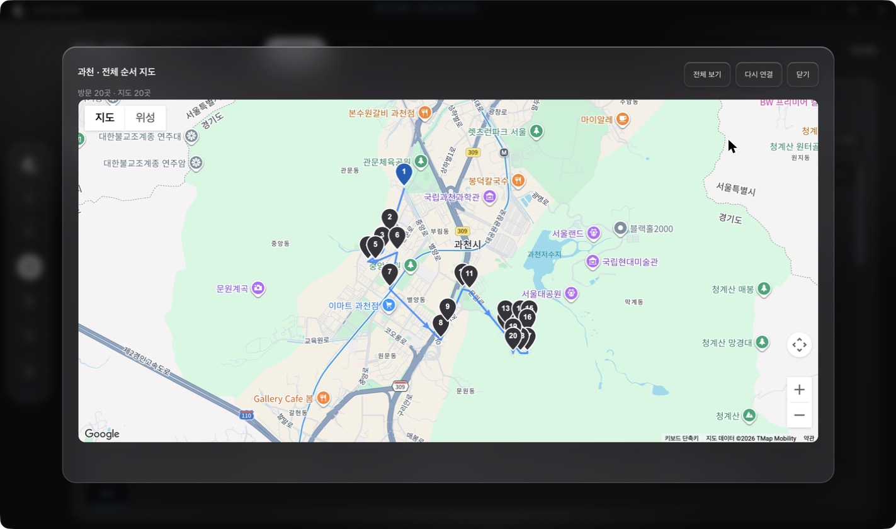
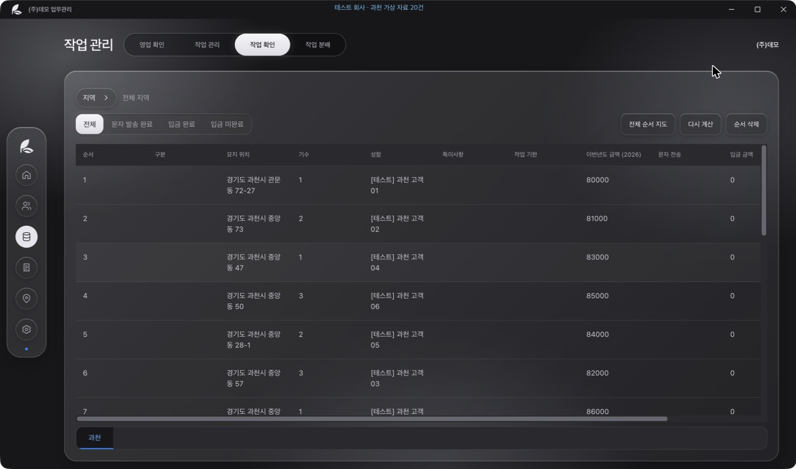
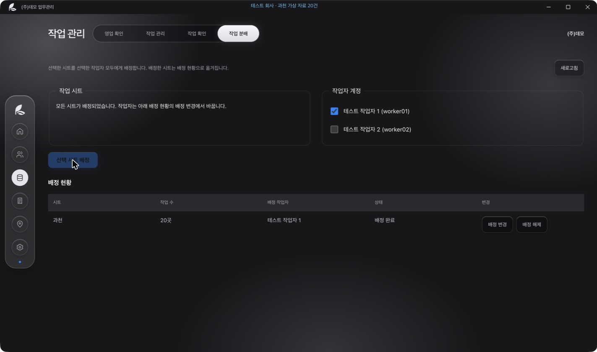
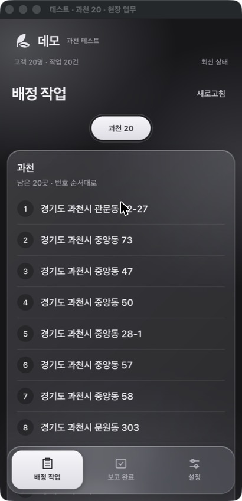
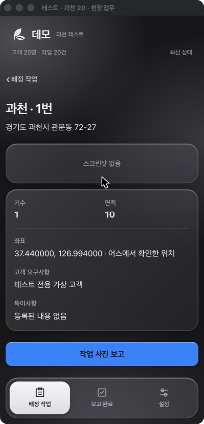
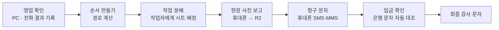
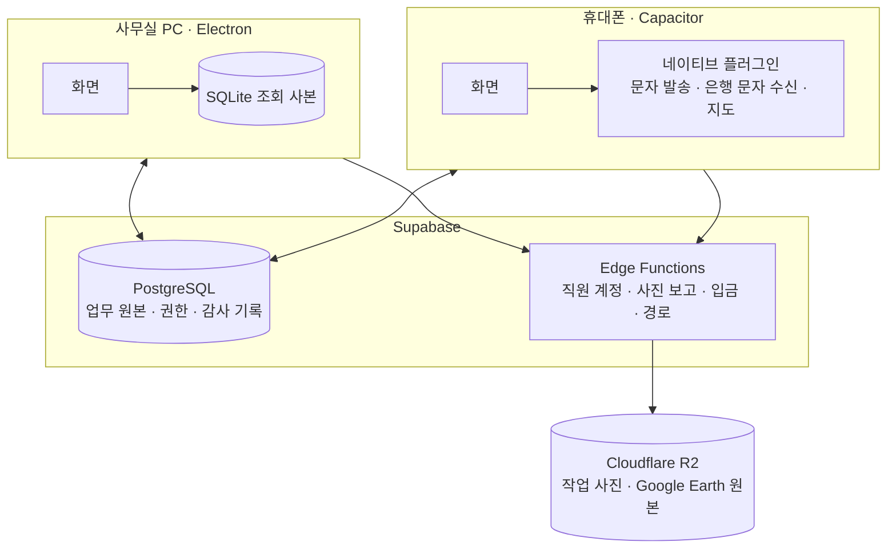

# 데모 업무 자동화

묘지 관리 회사의 **영업 전화 → 작업 순서 → 현장 사진 보고 → 청구 문자 → 입금 확인**을 하나로 잇는 업무 시스템입니다.
사무실 PC 프로그램, 현장 직원 휴대폰 앱, 그리고 둘을 연결하는 서버로 이루어져 있습니다.

> 이 저장소는 실제 회사에서 쓰고 있는 프로그램의 **공개본**입니다. 회사 이름, 계좌, 서버 주소, 고객 정보는 모두 가짜 값으로 바꿨습니다.

|            |                                                                                |
| ---------- | ------------------------------------------------------------------------------ |
| **사용자** | 사장님 · 마스터 · 부마스터 · 관리자 · 영업 · 현장 작업자 (6개 역할)            |
| **PC**     | Windows 데스크톱 프로그램 (Electron)                                           |
| **휴대폰** | Android · iPhone 앱 (Capacitor, 네이티브 플러그인 Java · Swift)                |
| **서버**   | Supabase (PostgreSQL · 인증 · Edge Functions), 사진 저장 Cloudflare R2         |
| **규모**   | 앱 코드 약 5만 줄, 서버 SQL 약 5,600줄, 테스트 약 5만 줄 · 자동 테스트 1,412개 |

## 화면

> 아래 화면은 모두 가짜 테스트 회사(과천 가상 고객 20명)로 찍었습니다.

**PC · 방문 순서 지도**: 진행하기로 한 20곳의 이동시간을 계산해 순서를 정하고 지도에 그립니다.



| PC · 방문 순서표                                  | PC · 작업 분배                                 |
| ------------------------------------------------- | ---------------------------------------------- |
|  |  |

| 휴대폰 · 배정 작업                                     | 휴대폰 · 작업 상세                                   |
| ------------------------------------------------------ | ---------------------------------------------------- |
|  |  |

PC에서 배정한 순서가 작업자 휴대폰에 그대로 나타나고, 한 곳을 누르면 좌표, 고객 요구사항, 특이사항을 보고 바로 사진 보고를 올릴 수 있습니다.

## 왜 만들었나

회사는 수백 명의 고객과 묘지를 엑셀, 전화, 종이로 관리하고 있었습니다.

- 해마다 고객에게 전화해 작업 여부를 묻고, 결과를 엑셀에 옮겨 적었습니다.
- 현장 작업 순서는 지도를 보며 사람이 정했고, 산속 묘지는 길 찾기가 되지 않았습니다.
- 작업이 끝나면 사진을 카톡으로 모아 청구 문자를 한 통씩 보냈습니다.
- 입금은 은행 문자를 보고 사람이 엑셀과 맞춰 봤습니다.

이 흐름을 한 시스템 안에서 이어지게 만드는 것이 목표였습니다.

## 업무 흐름



## 구조



- 업무 원본은 서버에 있고, 여러 PC와 휴대폰이 같은 자료를 봅니다. PC의 SQLite는 빠른 조회를 위한 사본입니다.
- 서버 연결은 `src/backend`(인증·데이터·실시간), 업무 처리는 `src/server`로 나눠 서버를 바꾸더라도 화면 코드는 그대로 두도록 했습니다.

## 기술적으로 신경 쓴 것

### 1. 운영 중인 데이터베이스를 안전하게 바꾸기

실제 고객 자료가 들어 있는 서버를 여러 번 바꿔야 했습니다. 한 번은 앱이 서버보다 먼저 배포돼 저장이 막힌 일도 있었습니다.

- **서버 판 동결**: 서버 SQL을 판(版)으로 묶어 내용과 지문(fingerprint)을 고정합니다. 지금까지 21개 판이 한 줄로 이어져 있고, 동결된 판은 다시 고칠 수 없습니다.
- **자료 보존 업그레이드**: 업그레이드 전후로 업무 표 52개의 모든 행 지문을 비교하고, 하나라도 다르면 전체를 되돌립니다.
- **무단 변경 차단**: PostgreSQL 이벤트 트리거로, 정해진 업그레이드 절차 밖에서 표나 함수가 바뀌면 막습니다.
- 적용 결과는 검사 SQL(`valid`, 미완료 0)로 확인합니다.

### 2. 운영 복사본으로 배포 전 리허설

테스트용 가짜 자료로는 실제 서버에서 나는 오류를 잡지 못했습니다. 그래서 운영 자료를 안전하게 복사한 **리허설 서버**를 만들었습니다(`scripts/staging/`).

- 운영 DB는 **읽기 전용 계정**으로만 읽습니다.
- 복사하면서 고객 이름을 **같은 이름 → 항상 같은 가짜 이름**으로 바꾸고, 끝난 뒤 실제 이름이 하나라도 남았는지 검사합니다.
- 리허설용 휴대폰 앱은 별도 앱 ID로 설치되고, 보내는 **모든 문자가 테스터 번호로만** 갑니다.
- `--from <버전>` 옵션으로 "지금 회사 PC에 깔린 버전 → 새 버전" 업데이트 과정 자체를 미리 돌려 볼 수 있습니다.

### 3. 여러 사람이 동시에 고칠 때

- 자료마다 버전(revision)을 두어, 다른 사람이 먼저 고친 자료를 덮어쓰지 않고 "최신 내용과 비교해 주세요"로 멈춥니다.
- 연결이 끊긴 상태에서 결과가 불확실하면 **같은 요청 번호로 다시 보내** 두 번 저장되지 않게 했습니다.

### 4. 개인정보와 권한

- 서버에는 업무에 필요한 필드만 보내고, 고객을 지워도 과거 청구·입금 기록은 확인할 수 있게 나눠 보관합니다.
- 6개 역할의 권한은 서버(SQL)와 앱(화면)에 같은 표로 두고, 두 표가 같은지 테스트로 확인합니다.
- 금융 자료는 권한이 있는 역할에게만 보입니다.

### 5. 은행 입금 문자 자동 대조 (Android)

- 은행 문자가 오는 휴대폰 한 대가 입금 문자를 받아 서버로 보냅니다.
- **이름과 금액이 확실히 하나의 청구와 맞을 때만** 자동으로 입금 처리하고, 애매하면 보류해 사람이 고르게 합니다.

### 6. 산속 묘지의 작업 순서

- 카카오 길 찾기로 이동 시간을 계산해 순서를 정합니다.
- 산속이라 길이 없는 곳은 실패로 끝내지 않고 **직선거리 기반 추정**으로 이어 계산하며, 어느 묘지가 추정인지 화면에 표시합니다.

## 테스트

```sh
npm ci && npm --prefix mobile ci
npm test                      # 단위·화면·SQL 테스트 1,412개
npm run format:check
```

- 서버 SQL은 **PGlite**(메모리에서 도는 PostgreSQL)로 실제와 같은 SQL을 실행해 검증합니다.
- 화면은 **jsdom**으로, 휴대폰 네이티브 코드는 Android 단위 테스트로 확인합니다.
- Docker 로컬 서버로 로그인·입금·동시 저장을 묶어 보는 통합 테스트가 따로 있습니다([로컬 테스트](docs/local-testing.md)).

## 기술 스택

| 영역        | 사용 기술                                                                     |
| ----------- | ----------------------------------------------------------------------------- |
| PC          | Electron, SQLite, ExcelJS                                                     |
| 휴대폰      | Capacitor, Java(Android), Swift(iOS)                                          |
| 서버        | Supabase(PostgreSQL 17, Auth, Realtime, Edge Functions · Deno), Cloudflare R2 |
| 지도        | 카카오 지도·길 찾기, Google Earth(KML/KMZ)                                    |
| 테스트·빌드 | node:test, PGlite, jsdom, Docker, esbuild, electron-builder, Prettier         |

## 폴더

```text
src/        PC 프로그램과 공용 업무 로직 (desktop · ui · shared · backend · server)
mobile/     휴대폰 앱 (src 화면 · android · ios)
database/   서버 SQL과 동결된 서버 판(cloud/releases)
supabase/   서버 함수
scripts/    빌드 · 서버 판 관리 · 리허설 · 로컬 테스트 도구
tests/      기능별 자동 테스트
docs/       사용 · 개발 · 설계 문서 (docs/superpowers/specs: 기능별 설계 기록)
```

## 현재 상태

- PC 프로그램과 서버는 회사에서 사용 중입니다.
- 남은 확인: 실제 갤럭시에서 은행 입금 문자 수신, 아이폰에서의 전체 업무 기능.
- 카카오톡 자동 접수와 감사 문자 자동 발송은 아직 만들지 않았습니다.
